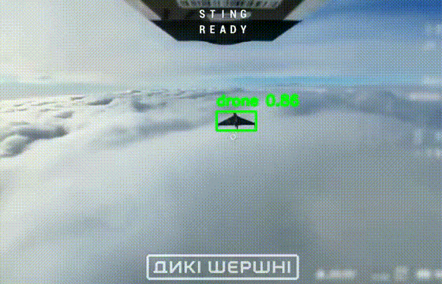
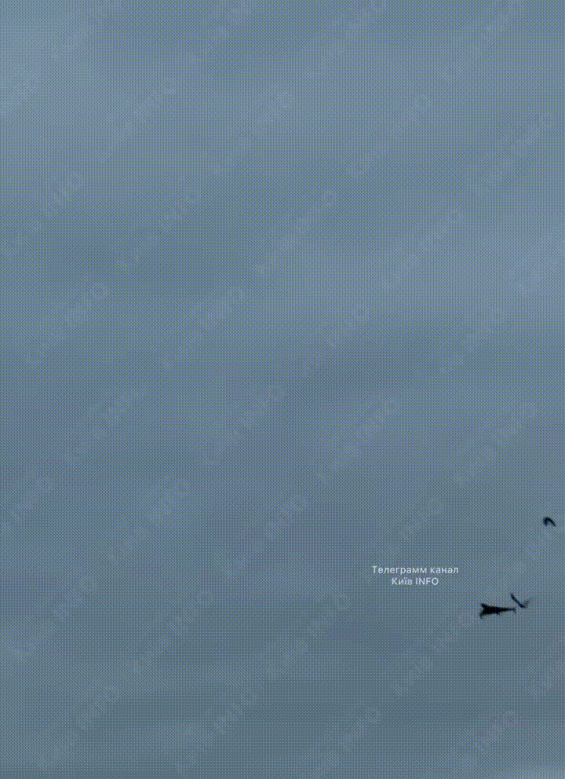
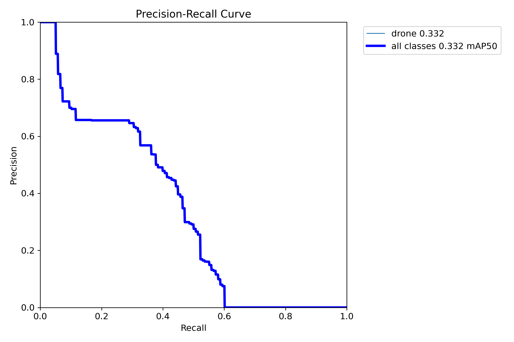
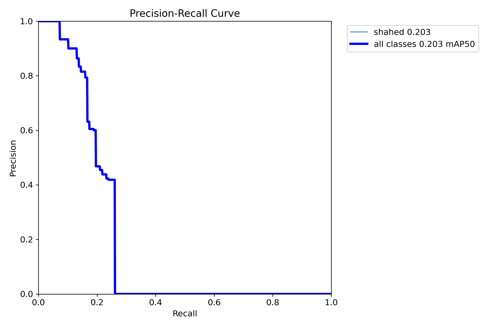

# Drone Detection with YOLOv8 + Synthetic Shahed Dataset (Blender → YOLO)

This project explores drone detection using YOLOv8.  
It starts with a baseline model trained on public drone/bird datasets and then narrows down to **single-class Shahed-type UAV detection** using a **synthetic dataset pipeline** (Blender rendering + compositing + YOLO labels).

> Educational / research project. No operational use.

## Demo




---

## Project Goals
- Train a baseline detector for flying objects (birds vs drones).
- Improve detection on UAVs using a drone detection dataset.
- Narrow the task to **single-class Shahed detection**.
- Build an end-to-end synthetic dataset pipeline:
  **3D model → rendered sprites → composited backgrounds → YOLO annotations → train → inference**.

---

## Datasets (external)
Baseline datasets used:
- Drone vs Bird (Kaggle): https://www.kaggle.com/datasets/muhammadsaoodsarwar/drone-vs-bird
- Drone Detection (Kaggle): https://www.kaggle.com/datasets/banderastepan/drone-detection

Synthetic Shahed dataset:
- 3D model: *(not included in this repository; see notes below)*
- Background images: *(not included in this repository)*

> This repo does not include datasets due to size/licensing.

---

## Repository Structure
- `scripts/generate_sprites_ds.py` — renders transparent PNG sprites (RGBA) from a 3D model in Blender.
- `scripts/compose_yolo.py` — composites sprites onto real backgrounds, generates YOLO bounding-box labels.
- `scripts/dataset_splitting_yolo.py` — splits dataset into train/val/test (70/20/10).
- `notebooks/train2.ipynb` — training in Google Colab (YOLOv8 fine-tuning).
- `scripts/inference-check.py` — local inference on video files and visualization.

---

## Setup
```bash
> pip install -r requirements.txt
```

## Synthetic Dataset Pipeline (Shahed)

1) Render sprites in Blender

Blender ≥ 4.x required for sprite generation.

Run Blender in background mode with the sprite generation script:
```bash
blender -b shahed2.blend -P scripts/generate_sprites_ds.py -- --out <SPRITES_DIR> --num 400 --res 640
```

## Compose sprites with backgrounds + create YOLO labels
```bash
python scripts/compose_yolo.py --sprites <SPRITES_DIR> --bgs <BACKGROUNDS_DIR> --out out --n 2000 --w 640 --h 640
```

## Split to train/val/test
```bash
python scripts/dataset_splitting_yolo.py
```

## Training (Google Colab)

Fine-tuning YOLOv8s on the synthetic single-class dataset.

Hyperparameters used:
- epochs=80
- batch=16
- patience=20

(Colab notebook: notebooks/train2.ipynb)

## Inference (Local)

python scripts/inference-check.ipynb

## Results

### Evaluation on real footage

The original validation metrics (mAP50 = 0.994, mAP50-95 = 0.991) were measured on a synthetic
val split that shares backgrounds and sprites with the training split (data leakage), so they
overestimate real-world performance.

To get an honest estimate, I collected and manually labeled a **real test set**:
82 frames from public videos, 138 Shahed instances, 5 frames without drones.
The split is done **by video**, so no video appears in both val and test.

| Model | Training data | mAP50 (synthetic val) | P | R | mAP50 | mAP50-95 |
|---|---|---|---|---|---|---|
| A | Public drone datasets (Drone vs Bird, Drone Detection) | — | 0.446 | **0.428** | **0.332** | **0.177** |
| B | A + synthetic Shahed v0.1 | 0.994 | 0.457 | 0.210 | 0.203 | 0.133 |

*Real test set. YOLOv8s (11.1M params), imgsz=640, Ultralytics 8.4.215.
P and R are reported at the confidence threshold that maximizes F1.*

| Model A | Model B |
|---|---|
|  |  |

### Findings

- **Domain gap:** model B drops from mAP50 0.994 on synthetic val to 0.203 on real frames.
- **Synthetic v0.1 hurt recall:** fine-tuning on synthetic data halved recall
  (0.43 → 0.21, i.e. 59 → 29 of 138 drones found). 
- **Likely causes:**
  - catastrophic forgetting (fine-tuned on synthetic data only, no real images);
  - object scale mismatch (synthetic objects ≥ 1% of the frame);
  - overly clean renders (no motion blur, noise, compression);
  - camera viewpoint (rendered mostly from above);
  - exactly one object per synthetic image vs ~1.7 per real frame.


## Notes on 3D Model / Backgrounds

The 3D model and background images are not included in the repository.
To reproduce the synthetic dataset, download:
- a Shahed-type 3D model (OBJ/GLB/GLTF) compatible with Blender
- a set of background images (sky/clouds/landscape) for compositing
